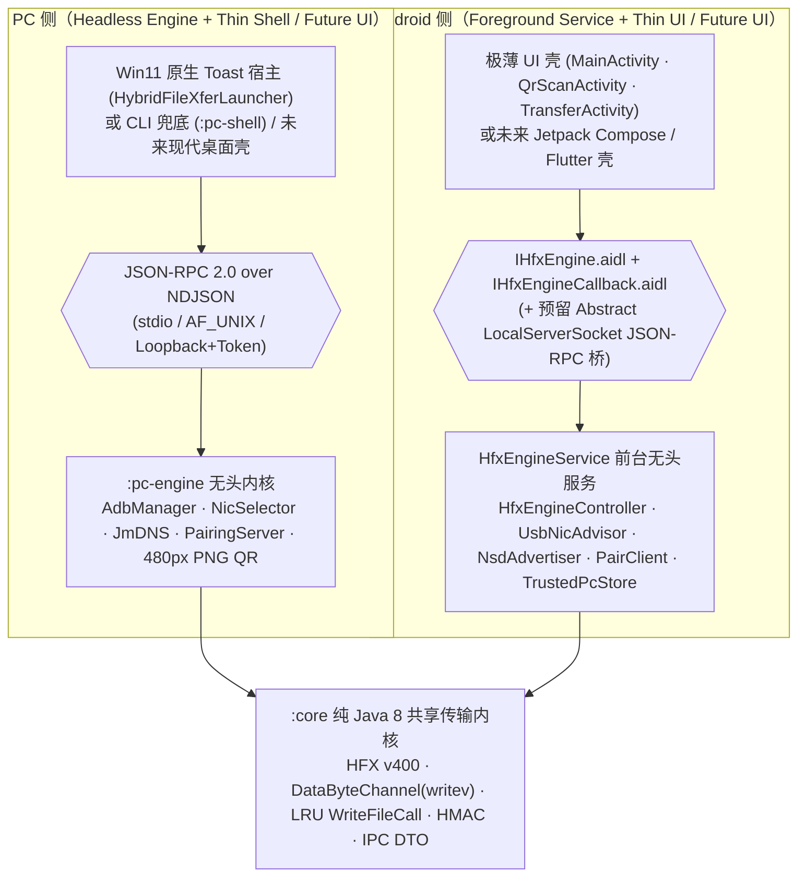

<div align="center">

# HFX-Revived

**Next-Generation Multi-Rail File Transfer Engine (HybridFileXfer v4 Overhaul)**

通过并行聚合 **USB 内核态虚拟网卡（NCM / RNDIS）**、**现代异步多流 ADB** 与 **6 GHz / 5 GHz Wi-Fi** 等多条异构 I/O 轨道，榨干移动设备与 PC 之间的物理带宽极限。

[](./LICENSE.txt)
[](https://github.com/Skydomainedge/HFX-Revived/actions/workflows/build.yml)
[](#architecture)
[](#monorepo-structure)
[](#quick-start)
[](#quick-start)
[](https://github.com/weixiansen574/HybridFileXfer)
[](#开发背景与-ai-协作声明)

[核心特性](#核心特性) · [架构设计](#architecture) · [当前阶段实测](#当前阶段实测与演进目标) · [快速上手](#quick-start) · [源码构建](#build-from-source) · [路线图](#roadmap) · [开发声明](#开发背景与-ai-协作声明) · [致谢与许可](#upstream-attribution--license)

</div>

---

> [!NOTE]
> **项目溯源与变更声明（GPL-3.0 Section 5a）**  
> **HFX-Revived** 是基于 [`weixiansen574/HybridFileXfer`](https://github.com/weixiansen574/HybridFileXfer)（v3.0.0-beta，基线提交 `14e75ab`）于 **2026 年 11 月**发起的深度架构重构衍生项目（`v4` 系列）。在保留上游多轨并行传输核心理念的基础上，对传输引擎、协议栈、有线高速轨、双端无头 IPC 解耦及零配置扫码发现进行了系统级重写。

> [!IMPORTANT]
> **维护者自述与 AI 协作透明声明（Vibe Coding）**  
> 本人目前仍处于 **Vibe Coding 学习阶段**，个人编码与大型工程管理能力有限；当前 `v4`（M1–M4）版本的核心架构重构、代码实现、自动化测试与文档体系均基于 **Google Antigravity（反重力）Agent 底座** 与 **Gemini 4 Neon (XHigh)** 模型协作完成。虽然项目内置了多模块单测、字节码红线守护与 SHA-256 校验脚本，但仍可能存在极端环境下的边界缺陷，建议传输重要数据前先小规模试传校验，也诚挚欢迎各位开发者通过 Issue / PR 指正与共建。

## 核心特性

- **HFX v400 高吞吐传输内核（`:core`）**
  - 修复底层部分写入（`writeFully`）风险，引入线程私有头缓冲与单次 `GatheringByteChannel` (`writev`) 聚集发送；
  - 统一 `4 MB` Socket 收发缓冲与 `TCP_NODELAY`，协议升级至 `VERSION_CODE = 400`，支持单轨多并发流、`HFXD` 显式数据通道握手与 `HMAC-SHA256` 会话鉴权；
  - 接收端引入访问序 LRU 多文件句柄池（`OpenFileHandle`），解决异构快慢轨乱序抵达导致的反复 `open / setLength / close` 抖动。
- **双轨并进的有线高速引擎**
  - **内核态 USB 网卡优先（`ncm*` / `usb*` / `rndis*`）**：Android 引擎一等公民识别 USB 虚拟网卡、自动探测只读 UDC 物理协商速率，并在检测到活动 USB 网卡时与 `USB_ADB` 自动互斥防止同线争抢；PC 端按最长前缀自动同网段 `bind` 源 IP，规避多网关与代理 TUN 劫持；
  - **现代 ADB 异步突发兜底**：PC `AdbManager` 自动降序探测最高版本 `adb`、进程级注入 `ADB_LIBUSB=1` / `ADB_BURST_MODE=1`（不污染系统环境变量），缺失 `delayed_ack` 时自动协商 4 并发流突破单流停等瓶颈。
- **双端无头业务内核与显示层 IPC 彻底剥离**
  - **PC 侧（`:pc-engine`）**：纯无头守护进程，零 UI/AWT/Swing 引用，通过统一 JSON-RPC 2.0 NDJSON 本地 IPC（`--ipc=stdio` Sidecar / `AF_UNIX` / Loopback + 一次性 `ipcToken`）向任意未来桌面壳（Tauri / WinUI 3 / Compose Desktop 等）提供服务；
  - **Android 侧（`HfxEngineService`）**：前台 `dataSync` 服务唯一持有 `HFXServer` 与 `IIOService`（支持普通 / Shizuku / Root）生命周期，通过 `IHfxEngine.aidl` 暴露同构契约，永久移除静态 `HFXServer.instance`，旋转屏幕或切后台传输零中断。
- **mDNS 零配置自动发现 + 图片式 PNG QR + Win11 原生通知**
  - 彻底摒弃控制台字符拼二维码：`:pc-engine` 内置纯 Java 零 AWT 编码器输出 **480×480 24-bit RGB PNG**，配对成功/取消/120s 过期/退出时强制清理临时文件；
  - 升级 C# .NET 8 `HybridFileXferLauncher` 为 Win11 原生 Toast 通知宿主（严守内联 `hint-crop="none"` 防裁切规范，支持「放大查看」/「取消」与配对后自动撤回）；
  - 多网卡清洗 `JmDNS` 监听 `_hfx._tcp.local.`，支持首次扫码后信任落盘与二次免扫码 `<1s` HMAC 自动秒连，并在 Windows 防火墙拦截 `:5741` 入站回调时自动切换 **mDNS `pair_ack` 反向兜底**；
  - Android 端提供零 GMS 离线 **CameraX + ZXing** 扫码框（头部一键唤起，识别后约 1s 状态动效反馈并平滑返回）。

---

<a id="当前阶段实测与演进目标"></a>
## 当前阶段实测与演进目标

| 阶段指标 | 实测情况 | 说明 |
|---|---|---|
| **当前阶段多轨聚合实测** | **~434 MB/s**（6 GHz Wi-Fi + USB 多轨聚合） | 相比旧版有线单流 ADB 停等（~40–50 MB/s）实现数量级跨越 |
| **当前测试环境瓶颈** | **受限于当前个人测试机有线网卡（2.5GbE）** | 434 MB/s 仅为当前硬件条件下的阶段性成绩，**并非本项目引擎架构的最终上限** |
| **后续硬件与极限目标** | **5 Gbps / 10 Gbps 有线网卡 + 多频 Wi-Fi 7 MLO / 高速 USB** | 后续硬件升级至 5GbE / 10GbE 网卡后，将结合下一代协议与调度算法继续冲击更高聚合带宽 |

> [!TIP]
> 本项目附带开箱即用的流式 SHA-256 完整性校验工具（[`scripts/verify-transfer-sha256.bat`](./scripts/verify-transfer-sha256.bat)），支持一键生成不可压缩随机测试集并跨 PC ↔ 手机逐文件校验字节大小与 `SHA-256` 100% 零受损。

---

<a id="architecture"></a>
## 架构设计与模块分层

通过 Gradle 多模块依赖关系与自动化字节码守护测试，从**编译期**杜绝传输业务内核反向依赖任何 UI / Console / View 框架：



<a id="monorepo-structure"></a>
### Monorepo 模块结构

| 模块 / 目录 | 语言与字节码基线 | 职责边界 |
|---|---|---|
| `:core` | Java 8（major 52） | 双端唯一共享传输引擎、HFX v400 协议、HMAC/配对编解码、统一 IPC DTO（严格零 Android / UI / `PrintStream`） |
| `:pc-engine` | Java 17 | PC 无头传输引擎守护进程，产出 `hfx-engine-*.jar`（严格零 AWT / Swing / Android / 业务 `PrintStream`） |
| `:pc-shell` | Java 17 | 极薄 CLI 壳与轻量 Win11 Toast 兜底，100% 向后兼容 `-c adb` / `-c <ip>`，产出 `hfx-shell-*.jar` |
| `HybridFileXferLauncher` | C# / .NET 8（Win11） | 原生 WinRT Toast 通知托管宿主（`--ipc=stdio`），负责无裁切 QR 展示、动作交互与配对自动撤回 |
| `:android` | Java 8 + JNI C++ | `engine/` 无头前台服务层（零 UI / `PrintStream` 字节码守护）+ 极薄展示壳与离线 CameraX/ZXing 扫码页 |
| `scripts/` | Batch / PowerShell | Windows 一键双击启动脚本（自动发现/扫码、ADB Turbo、USB 网卡/IP 直连、IPC 调试）与 SHA-256 校验器 |

---

<a id="quick-start"></a>
## 快速上手

### 环境要求
- **PC 端**：Windows 10/11（或 Linux/macOS 使用纯 Java CLI）、JDK 17+（推荐 JDK 21）；使用 Win11 原生 Toast 宿主需 `.NET 8` 运行时。
- **Android 端**：Android 7.0+（API 24+）；访问 `/Android/data` 等受限目录可选配合 [Shizuku](https://shizuku.rikka.app/)（ADB / Root 模式）。

### 方式一：零配置自动发现与 Win11 通知扫码绑定（推荐）

1. 在手机端安装 `android-debug.apk` 并授予文件读写权限。
2. PC 端双击 [`scripts/start-auto-pair.bat`](./scripts/start-auto-pair.bat)：
   - **首次绑定**：输入 `pair` 回车 → Windows 11 右下角弹出内联 **480×480 无裁切二维码**通知（支持「放大查看」与「取消」）；
   - **手机扫码**：点击手机主页顶部扫码图标 → 对准电脑二维码 → 识别后动效反馈约 1 秒并自动返回、拉起服务并建立 HMAC 加密多轨连接（若 Windows 防火墙拦截 `:5741`，2 秒内自动切换 mDNS `pair_ack` 反向兜底）；
   - **二次使用**：手机点击「启动服务器并等待连接」，PC 双击 `start-auto-pair.bat` 直接回车 → mDNS `<1s` 自动发现已信任设备并免扫码秒连。

### 方式二：快捷脚本与经典 CLI（100% 向后兼容）

| 场景 | Windows 一键脚本 | 等价命令行 |
|---|---|---|
| **自动发现 / 首次扫码** | `scripts/start-auto-pair.bat` | `HybridFileXferLauncher.exe [--pair]` 或 `java -jar hfx-shell.jar --auto` |
| **ADB 极速有线轨** | `scripts/start-adb-turbo.bat` | `java -jar hfx-shell.jar -c adb [-s <serial>] [--adb-streams=4]` |
| **USB 网卡 / Wi-Fi 直连** | `scripts/start-usb-nic-or-ip.bat` | `java -jar hfx-shell.jar -c <phone-ip> [-d <dir>]` |
| **无头引擎 IPC 守护** | `scripts/start-engine-ipc.bat` | `java -jar hfx-engine.jar --ipc=tcp://127.0.0.1:0` |
| **测速造数 & SHA-256 校验** | `scripts/verify-transfer-sha256.bat` | 详见 [`scripts/README_TESTING_GUIDE.md`](./scripts/README_TESTING_GUIDE.md) |

<details>
<summary><b>展开查看完整 CLI 参数与 JSON-RPC 2.0 本地 IPC 契约速查</b></summary>

#### PC CLI 参数（`hfx-shell-*.jar`）
```text
--auto                 自动 mDNS 发现已信任设备，未发现则推送 PNG QR 通知
--pair                 立即生成 480x480 PNG QR 并推送 Win11 通知
--no-toast             禁用 Win11 通知弹窗（仅输出 PNG 绝对路径）
-c, --connect=ADDR     adb 或手机网卡 IP（向后兼容旧版脚本）
-s, --device=SERIAL    多台 ADB 设备时指定序列号
-d, --dir=DIR          可选默认目录元数据（文件管理首屏默认展示盘符根目录 /）
--adb-path=PATH        指定额外的 adb 可执行文件路径
--adb-legacy           关闭进程级 ADB_LIBUSB / ADB_BURST_MODE 注入（便于对比测速）
--adb-streams=1..8     覆盖 USB_ADB 并发流数
--no-auto-bind         关闭同网段自动源 IP 绑定
```

#### 双端统一 IPC 命令与事件（`:core/ipc`）
- **命令**：`engine.get_snapshot`、`engine.refresh_nics`、`engine.shutdown`、`pair.start_qr`、`pair.cancel`、`pair.submit_qr_uri`、`peers.list`、`peers.remove`、`server.start`、`server.stop`、`session.connect`、`session.disconnect`、`fs.list`、`fs.mkdir`、`fs.delete`、`transfer.start`、`transfer.cancel`
- **推送事件**：`pair.qr_ready`、`pair.succeeded`、`pair.failed`、`pair.expired`、`mdns.peer_discovered`、`mdns.peer_lost`、`session.state_changed`、`rail.status`、`rail.conflict_resolved`、`adb.version_warning`、`diagnostic.warning`、`transfer.progress`（250ms 节流）、`transfer.completed`、`transfer.error`

</details>

---

<a id="build-from-source"></a>
## 源码构建与测试

在仓库根目录执行全量测试与产物构建（需本机配置 Android SDK / NDK `26.1.10909125` / CMake `3.22.1` 与 JDK 17/21）：

```powershell
# 1. 全量单元测试 + 无头引擎/薄壳 Fat JAR + Android Debug APK
.\gradlew.bat :core:test :pc-engine:test :pc-engine:shadowJar :pc-shell:test :pc-shell:shadowJar :android:testDebugUnitTest :android:assembleDebug --no-daemon

# 2. 编译 Windows 11 原生 Toast 宿主（Release）并运行防裁切 XML 自检
dotnet build HybridFileXferLauncher\HybridFileXferLauncher.csproj -c Release
.\HybridFileXferLauncher\bin\Release\net8.0-windows10.0.19041.0\HybridFileXferLauncher.exe --verify-toast-xml
```

构建产物默认输出至：
- `pc-engine/build/libs/hfx-engine-4.0.0-SNAPSHOT.jar`
- `pc-shell/build/libs/hfx-shell-4.0.0-SNAPSHOT.jar`
- `HybridFileXferLauncher/bin/Release/net8.0-windows10.0.19041.0/HybridFileXferLauncher.exe`
- `HybridFileXfer-Android/app/build/outputs/apk/debug/android-debug.apk`

---

<a id="roadmap"></a>
## 演进路线图（Roadmap）

- [x] **M1**：Monorepo 统一、HFX v400 多流与 HMAC 协议、`writev` / `writeFully` / LRU 句柄池修复、统一 IPC DTO
- [x] **M2**：PC `AdbManager`（高版择优 / 异步突发 / 4 流兜底）+ 同网段源 IP `bind` + Android `UsbNicAdvisor` 同线互斥
- [x] **M3**：双端无头业务内核与展示层 IPC 彻底剥离、PC 默认盘符首屏、快捷测试脚本与 SHA-256 校验器
- [x] **M4**：多网卡 `JmDNS` 零配置发现、纯 Java 480×480 PNG QR、Win11 原生 Toast 宿主、防火墙 `pair_ack` 反向兜底与离线扫码框
- [x] **v4.0.0-alpha.1（P0 生命周期热修）**：mDNS 并行有界超时关闭、Win32 Job Object（`KILL_ON_JOB_CLOSE`）进程树托管与子进程退出 JAR 零文件锁回归守护
- [ ] **下一阶段探索概要（v4.5 / v5 单指标立项与分阶演进规划）**：
  - **阶段一 · `v4.5-a`（工程治理、提权/白盒策略与三层重业务解耦）**：
    - **代码质量与防僵尸生命周期规范**：拆解大型状态协调器、结构化诊断黑匣子（每轨 RTT/吞吐/根因码）、全关闭路径分级并行有界超时、非守护线程零泄漏审计与双路径退出零残留 CI 守卫；
    - **四级提权栈 × 双面人工白盒策略 × 智能决策引导**：建立 `App Normal` / `Shizuku-ADB` / `Sui` / 原生 `Direct-Root`（KernelSU·Magisk，彻底脱钩 Shizuku）四级提权逐层能力匹配，提供「授权路径白盒化 + 管线决策白盒化」全透明操控、一键紧急回滚及基于硬件/遥测指纹的智能推荐引导；
    - **接入许可 / 控制面 / 数据管线三层解耦**：彻底分离 L1 发现许可、L2 独立控制会话与 L3 多轨数据面生命周期，根治 mDNS/扫码场景启用 `USB_ADB` 管线时的建连失败，实现按需拉起 `adb forward` 与单轨不可达优雅降级；
    - **主流代理与软路由直连避坑**：保障 PC（Clash/Mihomo `Meta Tunnel`、Wintun、WireGuard、旁路由）与 Android（`VpnService tun0`）环境下私有网段直连与扫码必通。
  - **阶段二 · `v4.5-b`（物理链路平行极限、代理深治、Root 零挂载基座与底座现代化）**：
    - **USB 极限与 ColorOS 同线四协议归因**：横向实测标定 MTP vs RNDIS vs CDC-NCM（`qmult` / NTB / Win11 `UsbNcm.sys`）vs `adb over NCM` 旁路加速，支持会话期多轨动态热插拔与共享 `adb daemon` 防连坐清理；
    - **Wi-Fi 7 MLO、多频并发与驱动配置归因**：全链路木桶分段标定（5GbE/10GbE 回程与路由 STR/EMLSR）、单口 MLO 自适应流数拐点、多物理网卡并发与只读驱动配置边界分析；
    - **独立 VPN / 透明代理与隐藏态代理路由治理**：面向无 `tun0` 透明代理（eBPF / `TPROXY` / `nftables`）与隐藏态 VPN 场景，构建不依赖表象标志的真实路径探测归因与分提权层白盒直连协同；
    - **Root / KernelSU 零挂载运行态平行调优基座**：以对称插件（USB ∥ Wi-Fi ∥ 私有路由 ∥ 进程守护）在纯运行态落地 `ncm,adb`、`qmult`、RPS/IRQ 错核绑核与分介质拥塞实测，配套 `pipe EOF`/`pidfd` 崩溃自愈看门狗与 `tmpfs` 快照（异常强杀 ≤5s 无痕回滚，非 Root 设备 100% 优雅降级；可选用户态配置模块仅在运行态证伪后条件评估，内核态 KPM 驱动改造明确划出主仓）；
    - **工具链、依赖库与 CI 现代化**：评估 Gradle/AGP/CameraX 升级、Android 15+ 原生 `.so` 16 KB ELF 页对齐、`targetSdk 35` 前台服务合规、`jmdns:3.5.9` 线程泄漏根治及 GitHub Actions Windows Runner 常态化门禁。
  - **阶段三 · `v5.0`（下一代传输引擎与现代跨端 UI 壳）**：
    - **断点续传与原地整片整合**：Chunk Bitmap/Journal 持久化、`.hfxpart` 原地乱序写与原子 `rename`（零二次磁盘拷贝）及分片级快速校验；
    - **海量小文件管线与异构调度算法**：在线内存归并流（Streaming Bundle，零临时归档文件）与异构快慢轨动态块分配及尾段工作窃取（Work-Stealing）；
    - **现状体验基线与现代跨端 UI 壳演进**：基于版本化 IPC 契约承载双面白盒控制台、智能引导卡片与独立成行快捷路径跳转标签栏，并将 OS 内核级进程树托管（Windows Win32 Job Object / Linux `PDEATHSIG` / macOS `kqueue`）列为全壳强制准入红线。

---

<a id="开发背景与-ai-协作声明"></a>
## 开发背景与 AI 协作声明

- **个人能力与维护边界**：本项目由维护者在 **Vibe Coding 学习与实践** 过程中发起推进。由于个人专业开发经验、底层排障与大型仓库代码管理能力仍然有限，项目迭代节奏、疑难 Issue 响应及复杂跨设备适配可能存在不足，敬请谅解；传输重要资料时请务必结合自带的 `verify-transfer-sha256.bat` 做完整性核验。
- **AI 工程底座与模型信息**：当前 `v4`（M1–M4）版本的架构设计推进、代码重构、单测编写与实机级回归验证，主要基于 **Google Antigravity（反重力）Agent 底座**，驱动模型为 **Gemini 4 Neon (XHigh)**。
- **质量兜底手段**：为弥补人工代码审查的局限，仓库通过编译期模块隔离、字节码架构红线守护（零 UI/非法依赖检查）、端到端环回集成测试与 SHA-256 一致性校验来尽量保证工程可靠性。

---

## 参与贡献

欢迎通过 Issue 反馈问题与性能实测数据，更欢迎有经验的开发者直接提交 Pull Request 协助审阅与优化代码。提交前请确保本地全量 Gradle 单测（含字节码分层红线守护）与 `.NET` 构建全部通过。

---

<a id="upstream-attribution--license"></a>
## 致谢与开源协议

### 上游溯源与致谢
- 衷心感谢原项目作者 [**weixiansen574**](https://github.com/weixiansen574) 创建并开源 [`HybridFileXfer`](https://github.com/weixiansen574/HybridFileXfer)，奠定了多轨异构文件传输的核心思路与最初的双端实现。
- 感谢以下优秀开源项目提供的底层能力：[Shizuku](https://github.com/RikkaApps/Shizuku)、[ZXing](https://github.com/zxing/zxing)、[JmDNS](https://github.com/jmdns/jmdns)、[AndroidX CameraX](https://developer.android.com/training/camerax)、[Gson](https://github.com/google/gson)、[Windows Community Toolkit](https://github.com/CommunityToolkit/WindowsCommunityToolkit)。

### 许可证
本项目整体遵循 **GNU General Public License v3.0 (GPL-3.0)** 开源协议，完整协议条款请参阅 [LICENSE.txt](./LICENSE.txt)。基于本项目的任何修改与再分发须遵守 GPL-3.0 协议要求，保留原版权声明、变更说明与完整源代码获取途径。
